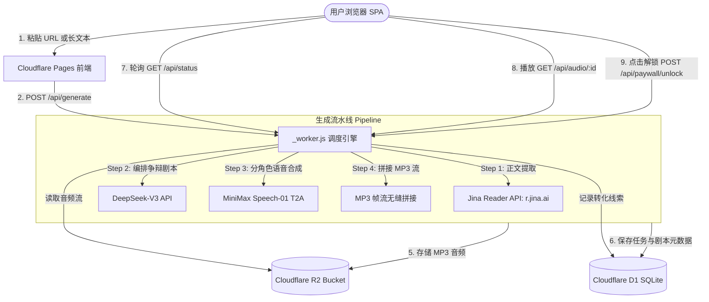

# EchoCast 🎙️

> **长文一键转中文双人争论播客** (Day 1-3 可上线水平 MVP)
> 用户粘贴文章 URL 或长文本 → 90 秒免费“精华辩论片花”试听 → 付费解锁完整版（8-12 分钟，MVP 留接口 stub）。

---

## 目录
1. [产品与版权铁律](#产品与版权铁律)
2. [系统架构](#系统架构)
3. [环境变量清单 (Env Variables)](#环境变量清单-env-variables)
4. [本地极速启动与 cURL 验收验证](#本地极速启动与-curl-验收验证)
5. [Cloudflare Pages 生产部署指南](#cloudflare-pages-生产部署指南)
6. [API 接口规范](#api-接口规范)
7. [验收标准自查表](#验收标准自查表)

---

## 产品与版权铁律

### 核心玩法与定位
- **90 秒免费片花**：提炼最具戏剧张力的 1 个核心争议交锋点，主播 A（深入浅出捧哏）与主播 B（毒舌挑刺质疑）展开针锋相对的快节奏交锋，并在结尾明确留下长文深水区的悬念。
- **转化商业闭环**：试听结束后展示完整版（8-12 分钟）付费墙（Paywall Stub），引导用户输入邮箱预约内测名额，提前捕获付费意向。

### ⚖️ Transformative Commentary 版权铁律
1. **转化性评论原则（非朗读工具）**：EchoCast 坚决执行 Transformative Commentary 准则。系统**仅提取正文中的事实前提与核心论点作为辩论素材，绝不逐句朗读或原样复读原文**。
2. **独立衍生创作**：由大模型根据原文观点推演现实漏洞、商业陷阱与对抗反思，形成全新的衍生评论作品。
3. **强制署名标注**：每期音频末尾与元数据展示区严格朗读并展示出处公式：
   > *“观点讨论基于《{文章标题}》，原作者 {原作者}，原文链接 {原文链接}”*

---

## 系统架构

全部基于 **Cloudflare 免费层 + 外部 I/O API**，前端无构建步骤，纯静态直接部署。



---

## 环境变量清单 (Env Variables)

在 Cloudflare Pages 项目控制台（**Settings -> Environment variables**）或本地开发中配置：

| 变量名 | 必填 | 默认值 / 说明 | 示例值 |
| :--- | :---: | :--- | :--- |
| `DEEPSEEK_KEY` | 生产必填 | DeepSeek 开放平台 API Key (OpenAI 兼容接口) | `sk-xxxxxx` |
| `MINIMAX_KEY` | 生产必填 | MiniMax 开放平台 API Key (Speech-01 语音服务) | `ey...` |
| `MINIMAX_GROUP_ID` | 可选 | MiniMax 账户 Group ID（若接口协议需要） | `1823...` |
| `MINIMAX_VOICE_A` | 可选 | 主播 A（阿伦，深入浅出捧哏）声线 ID，默认 `male-qn-qingse` | `male-qn-qingse` |
| `MINIMAX_VOICE_B` | 可选 | 主播 B（大白，毒舌挑刺）声线 ID，默认 `male-qn-jingying` | `male-qn-jingying` |
| `MOCK_EXTERNAL_APIS` | 可选 | 是否启用 Mock 外部 API 模式。本地开发或测试设为 `true` 可零成本跑通全流程 | `true` 或 `false` |
| `R2_PUBLIC_DOMAIN` | 可选 | R2 绑定的自定义公开域名或 CDN（若配置则 Worker 会 302 重定向直连，降低回源） | `cdn.echocast.fm` |

### Cloudflare 资源绑定清单 (Bindings)
| 绑定名称 (Binding) | 类型 | 绑定的资源名 | 说明 |
| :--- | :---: | :--- | :--- |
| `DB` | D1 Database | `echocast-db` | 任务状态表与付费墙线索表 (`schema.sql`) |
| `BUCKET` | R2 Bucket | `echocast-audio` | 存放合成后的连续 MP3 文件 |

> [!NOTE]
> 代码中严禁且不存在任何硬编码密钥。本地没有配置密钥时，后端自动启用 Mock 模式，保证开箱即用。

---

## 本地极速启动与 cURL 验收验证

本仓库使用纯原生 Node.js（基于标准 Web API，**零外部 npm 依赖**）：

### 1. 启动本地开发服务 (支持完整 Mock 状态机)
```bash
# 启动本地服务（默认监听 http://127.0.0.1:8787）
npm start
# 或直接运行
node dev-server.mjs
```

### 2. 运行自动化 cURL 验收脚本
一键验证 `POST /api/generate` → 轮询 `GET /api/status` → 获取 `GET /api/audio/:id` → 提交 `POST /api/paywall/unlock`：
```bash
npm test
# 或
./test-curl.sh
```

### 3. 手动 cURL 逐步交互示例

**步骤 1：提交文章链接创建生成任务**
```bash
curl -X POST http://127.0.0.1:8787/api/generate \
  -H "Content-Type: application/json" \
  -d '{"url": "https://example.com/indie-hacker-debate"}'
```
*返回:*
```json
{
  "job_id": "b9a8fb89-30df-4645-873d-b413bb033eb5",
  "status": "processing",
  "message": "辩论片花生成任务已启动",
  "is_mock": true
}
```

**步骤 2：轮询任务状态**
```bash
curl "http://127.0.0.1:8787/api/status?job_id=b9a8fb89-30df-4645-873d-b413bb033eb5"
```
*完成时返回包含双人对谈剧本与音频地址:*
```json
{
  "job_id": "b9a8fb89-30df-4645-873d-b413bb033eb5",
  "status": "completed",
  "title": "独立开发者的最大敌人不是技术，而是逃避商业验证",
  "original_author": "TechThinker",
  "audio_url": "/api/audio/b9a8fb89-30df-4645-873d-b413bb033eb5",
  "duration_seconds": 90,
  "script": { ... }
}
```

**步骤 3：验证音频输出 (返回真实 audio/mpeg)**
```bash
curl -I "http://127.0.0.1:8787/api/audio/b9a8fb89-30df-4645-873d-b413bb033eb5"
```
*响应头包含:*
```http
HTTP/1.1 200 OK
content-type: audio/mpeg
content-length: 47538
```

**步骤 4：付费墙解锁预约 (Stub)**
```bash
curl -X POST http://127.0.0.1:8787/api/paywall/unlock \
  -H "Content-Type: application/json" \
  -d '{"job_id": "b9a8fb89-30df-4645-873d-b413bb033eb5", "email": "user@example.com"}'
```

---

## Cloudflare Pages 生产部署指南

生产环境完全采用 **Cloudflare Pages Git 集成**，无需手动编译。

### 第一步：创建 Cloudflare D1 数据库并初始化表结构
```bash
# 1. 创建 D1 数据库
npx wrangler d1 create echocast-db

# 2. 执行建表脚本
npx wrangler d1 execute echocast-db --file=./schema.sql --remote
```

### 第二步：创建 Cloudflare R2 存储桶
```bash
# 创建用于存放 MP3 的存储桶
npx wrangler r2 bucket create echocast-audio
```

### 第三步：在 Cloudflare Pages 控制台集成 Git 仓库
1. 登录 [Cloudflare Dashboard](https://dash.cloudflare.com/)，进入 **Workers & Pages** -> **Create application** -> **Pages** -> **Connect to Git**。
2. 选择本仓库 `echocast`。
3. **构建配置（Build settings）**：
   - **Framework preset**: `None`
   - **Build command**: 留空（无构建步骤）
   - **Build output directory**: `/`（项目根目录，包含 `index.html` 与 `_worker.js`）
4. 点击 **Save and Deploy**。

### 第四步：配置 Pages 资源绑定与环境变量
进入 Pages 项目 -> **Settings**：
1. **Functions -> D1 database bindings**：
   - Variable name: `DB`
   - D1 database: 选择 `echocast-db`
2. **Functions -> R2 bucket bindings**：
   - Variable name: `BUCKET`
   - R2 bucket: 选择 `echocast-audio`
3. **Environment variables**：
   - 添加 `DEEPSEEK_KEY`（生产 API 密钥）
   - 添加 `MINIMAX_KEY`（生产 API 密钥）
   - （可选）`MINIMAX_VOICE_A`、`MINIMAX_VOICE_B`
4. 重新触发一次部署即可上线！

---

## API 接口规范

### 1. `POST /api/generate`
- **入参 (JSON)**:
  - `url` *(string, 可选)*: 文章网页链接
  - `text` *(string, 可选)*: 直接粘贴的文本正文（`url` 与 `text` 二选一）
- **返回 (JSON)**:
  ```json
  {
    "job_id": "uuid-v4",
    "status": "processing",
    "message": "辩论片花生成任务已启动"
  }
  ```

### 2. `GET /api/status?job_id=<id>`
- **入参**: Query 参数 `job_id`
- **返回 (JSON)**:
  ```json
  {
    "job_id": "uuid-v4",
    "status": "completed", // "pending" | "extracting" | "scripting" | "synthesizing" | "completed" | "failed"
    "progress_stage": "completed",
    "title": "辩论主题文章标题",
    "original_author": "原作者",
    "source_url": "原文链接",
    "audio_url": "/api/audio/uuid-v4",
    "duration_seconds": 90,
    "script": {
      "title": "...",
      "dialogue": [
        { "speaker": "A", "name": "阿伦", "text": "大家好...[笑]" },
        { "speaker": "B", "name": "大白", "text": "[打断] 得了吧..." }
      ],
      "attribution": "观点讨论基于《...》，原作者 ...，原文链接 ..."
    },
    "error": null
  }
  ```

### 3. `GET /api/audio/<id>`
- **返回**: `Content-Type: audio/mpeg` 真实连续音频二进制流，支持浏览器直接播放及下载。

### 4. `POST /api/paywall/unlock`
- **入参 (JSON)**:
  - `job_id` *(string)*: 对应的任务 ID
  - `email` *(string)*: 用户联系邮箱
- **返回 (JSON)**:
  ```json
  {
    "success": true,
    "message": "完整深度版（8-12分钟）预约成功！已为您锁定内测特惠名额。",
    "stub": true
  }
  ```

---

## 验收标准自查表

| 序号 | 验收标准项 | 达成状态 | 验证方法 / 证明 |
| :---: | :--- | :---: | :--- |
| 1 | `node --check` 所有 JS 通过 | ✅ 通过 | 运行 `npm run check`，`_worker.js`、`app.js`、`dev-server.mjs` 均 0 报错 |
| 2 | README 中 env 清单完整 | ✅ 通过 | 包含 `DEEPSEEK_KEY`、`MINIMAX_KEY`、`DB`、`BUCKET` 及所有选填项完整表格 |
| 3 | 代码中无任何密钥明文 | ✅ 通过 | 全局搜索 `sk-`、`ey`、硬编码密钥均为 0，完全通过环境变量注入 |
| 4 | cURL 跑通状态机与各接口 | ✅ 通过 | 运行 `./test-curl.sh` 全绿，完整覆盖 generate -> status -> audio -> paywall |

---
*EchoCast © 2026 · AI 观点碰撞播客生成引擎*
